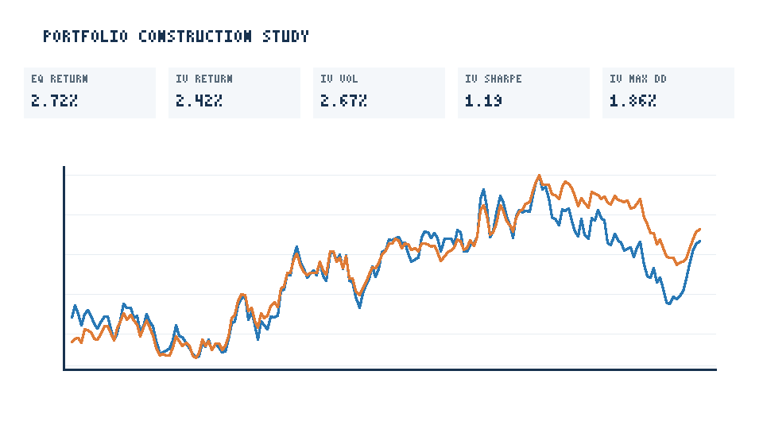
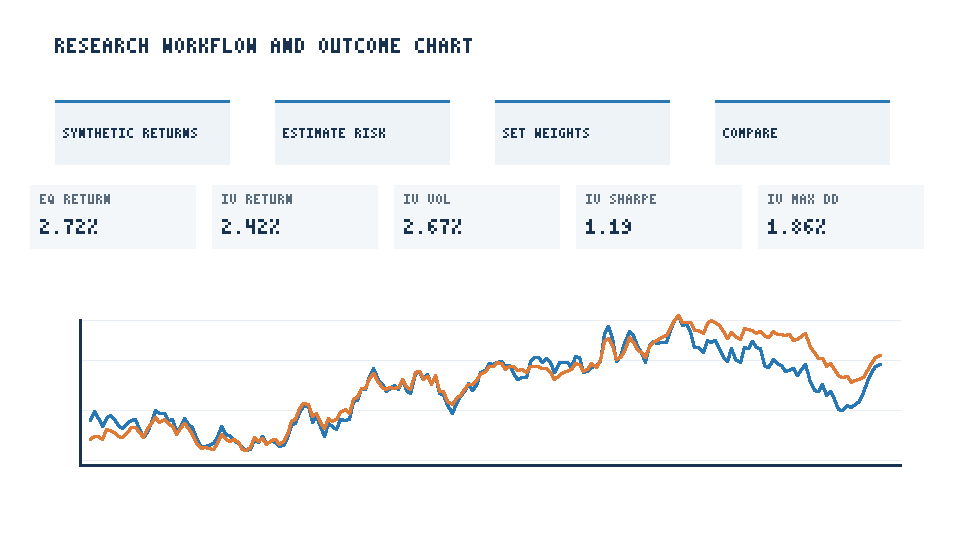

# Portfolio Construction Study

A reproducible, standard-library-only comparison of equal-weight and capped inverse-volatility allocations on deterministic synthetic daily returns.

## Run

From this directory:

```sh
PYTHONPATH=src python3 -m portfolio_construction_study
PYTHONPATH=src python3 -m unittest discover -s tests -v
```

The CLI accepts `--seed`, `--observations`, `--lookback`, `--max-weight`, `--output`, and `--reports`. It writes synthetic asset returns, daily portfolio returns, summary metrics, and regenerates the PNG/SVG charts.

## Method and limitations

Four synthetic asset return streams are generated with distinct volatility and modest common-factor exposure. Inverse-volatility weights are estimated from the initial lookback window only, capped at the configured maximum, and then held fixed; equal weights are the transparent reference. The summary now includes per-asset estimated volatility and per-strategy total/geometric annualized return, annualized volatility/downside deviation, zero-risk-free-rate Sharpe-like ratio, maximum drawdown, daily win rate, best/worst day, and historical 95% daily VaR/CVaR. Screenshots show key allocation outcomes alongside cumulative growth charts. No optimizer, covariance estimation, rebalancing, transaction cost, financing, taxes, or constraints beyond a per-asset cap are modeled. The arbitrary synthetic sample is not evidence of investment performance or a recommendation.

## Screenshots



[Overview SVG](reports/overview.svg)



[Workflow SVG](reports/workflow.svg)
